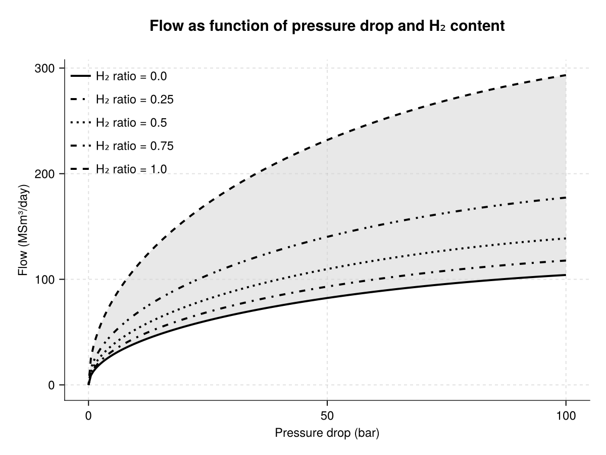
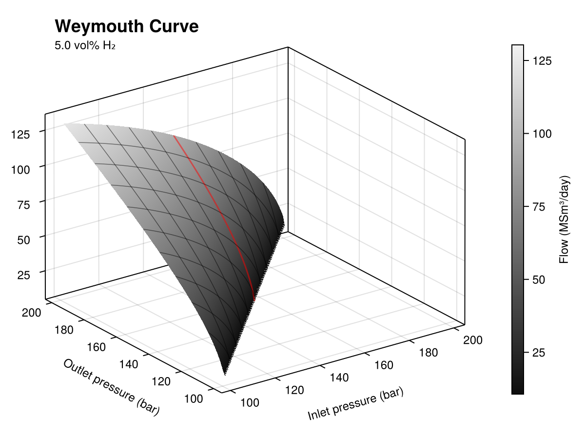
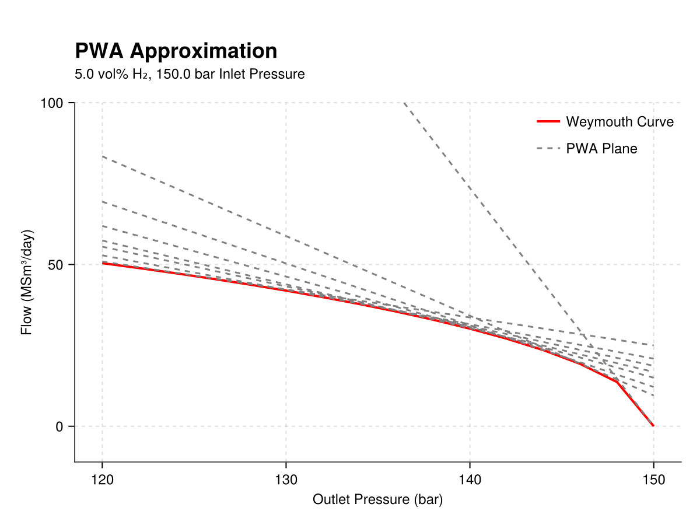

# [Theoretical Background](@id method)

```@index
Pages = ["method.md"]
```

The following sections describe the two methodologies employed to solving the admixing problem in gas networks.

## [Pooling Problem](@id method-pooling)

The pooling problem captures how different gas sources mix as they move through a network. Because sources may inject different gas types (or “commodities”), the resulting model is naturally **multi-commodity**, and it becomes necessary to track and constrain mixture composition at intermediate nodes and at terminals.

We define a directed graph ``G = (N, A)``, where ``N`` is the set of nodes and ``A`` the set of arcs. Each arc ``(i,j) \in A`` has a known capacity ``b_{(i,j)}``. Let us denote the out-neighbours of node ``i`` by ``N^+_{i} = \{j \in N : (i,j) \in A\}`` and the in-neighbours by ``N^-_i = \{ j \in N : (j, i) \in A\}``. We distinguish:

- **Sources** ``S``: nodes with no incoming arcs (``N^-_s = \emptyset`` for ``s \in S``).
- **Terminals** ``T``: nodes with no outgoing arcs (``N^+_t = \emptyset`` for ``t \in T``).
- **Pooling Nodes** ``I``: nodes where incoming flows are blended linearly, meaning the proportion (or "quality") of each commodity at ``n``is a weighted average of upstream proportions, with weights given by the incoming arc flows. (``I = N \setminus (S \cup T)``)

Let ``K`` denote the set of commodities. The parameter ``q^k_s`` represents the proportion of the commodity ``k`` injected from source ``s``. This parameter equals 1 if source ``s`` supplies commodity ``k`` and 0 otherwise. For each node ``n \in N \setminus S``, the parameters ``\overline{q}^k_n`` and ``\underline{q}^k_n`` define the maximum and minimum proportion bound, respectively. 

`EnergyModelsGasNetworks` assigns flow values that respect the quality bounds at terminals and pooling nodes. The extension implements the *generalised pooling problem* [hellemo_generalized_2016](@cite), which extends the classical formulation to permit pool-to-pool and source-to-terminal connections, includes processing facilities (nodes that separate or convert gas streams), and enforces composite quality constraints (bounds on component fractions rather than on absolute totals). Qualities at interior nodes depend on recursive mixing and can lead to nonconvex problems in the general case.

### Formulation approach

Several formulations of the pooling problem appear in the literature. The original S-formulation (source-tracking) from [alfaki_multi-commodity_2013](@cite) introduces variables ``y^s_i`` for the fraction of flow at node ``i`` originating from source ``s``. The bilinear products ``y^s_j \times f_{(j,t)}`` that appear in the mixing recursion and quality constraints scale as ``O(|S| \times |A| \times |T|)`` — proportional to the number of sources, arcs, and time periods. In a multi-period investment model with many sources and a long planning horizon this produces an excessive number of nonlinear terms.

`EnergyModelsGasNetworks` instead adopts the P-formulation, tracking the fraction of each blend component ``p \in P`` at each interior node through the variable ``\text{proportion\_out}[n, t, p]``. Bilinear products ``\text{proportion\_out}[n] \times f_l`` scale as ``O(|I| \times |P| \times |T|)`` — proportional to pooling nodes, components, and time periods. For a binary methane–hydrogen blend (``|P| = 2``), this is substantially smaller than the S-formulation for typical gas networks.

Two further specialisations reduce or eliminate the remaining bilinear terms:

- **`BlendingNode`**: at junctions with a single outgoing blend link, the component mass balance alone determines output composition. No `proportion_out` variable is needed and no bilinear products arise. This covers the majority of interior nodes in a transmission network (pre-sink mixing, post-source injection, single-corridor transit).
- **`DiscretizedPoolingNode`**: replaces the bilinear product at multi-output pooling nodes with a piecewise-linear MILP approximation, making the full model solvable by standard MILP solvers without MINLP machinery.

### Component flow tracking

Each link ``l`` carrying a blend has a flow ``f_{l,t,p}`` (`flow_component`) for each
component ``p``, which add up to the blend flow. At every node, the component flows are
balanced linearly: the outflow of each component equals its inflow plus injection (e.g. raw
H₂ at a [`BlendingNode`](@ref)) minus extraction (at a [`DeblendNode`](@ref)). Where blend
mixes into a single outflow, this balance determines the composition exactly.

Quality bounds on component ``p`` are linear in the component flows:
``
    \underline{q}^p_n \sum_{l} f_{l,t} \leq \sum_{l} f_{l,t,p} \leq \overline{q}^p_n \sum_{l} f_{l,t},
    \quad \forall n, t, p
``

The share ``\text{proportion\_out}[n, t, p]`` of component ``p`` is only tracked at the nodes
that need it (see [`blend_share_plan`](@ref EnergyModelsGasNetworks.blend_share_plan)):

- **Composition sources**, whose outflows must all carry the same mixture: pooling nodes
  where the blend splits, and blend storages in mode `:prescribed` or `:fully_mixed`. At a
  [`PoolingNode`](@ref) with outgoing blend links ``\mathcal{L}^+_n``,
  ``
      f_{l,t,p} = \text{proportion\_out}[n, t, p] \cdot f_{l,t}, \quad \forall l \in \mathcal{L}^+_n
  ``
  which is the only bilinear term of the formulation. A [`DiscretizedPoolingNode`](@ref)
  approximates it with binary variables.
- **Weymouth pipes** with `BlendLinkData`, whose PWA depends on the share of the tracked
  resource in the pipe. The share is read from the inflow node if it is a composition
  source. Otherwise, it is read from the first pooling node downstream, if the pipe is its
  only blend inflow (possibly through passthrough nodes with one inflow and one outflow), as
  the composition is then the same along the path. As a last option, the share is copied
  linearly from composition sources upstream along passthrough nodes such as `TransitNode`,
  which requires their simultaneously active inflows to have the same composition.

A passthrough node with several outgoing blend links lets at most one of them carry flow in
each period, so it needs no share. Sinks, unit conversions and merges use the component
flows. A Weymouth pipe for which no end provides the share is rejected: a pooling node is
then required upstream of it.

### Node types for pooling

`EnergyModelsGasNetworks` offers four node types for handling blend composition at interior
network junctions, with different trade-offs between model complexity and solver requirements:

| Node type | Formulation | Bilinear terms | Solver |
|---|---|---|---|
| [`PoolingNode`](@ref) | Bilinear (P-formulation) | Yes — ``\text{proportion\_out}_{n,t} \times f_{l,t}`` | MINLP (e.g. SCIP) |
| [`DiscretizedPoolingNode`](@ref) | Piecewise linear (MILP) | None | MILP (e.g. HiGHS) |
| [`BlendingNode`](@ref) | Linear (single output only) | None | LP/MILP |
| [`DeblendNode`](@ref) | Linear (processing facility) | None | LP/MILP |

**`PoolingNode`** uses the standard bilinear mixing constraint:
```math
\text{flow\_component}[l, t, p] = \text{proportion\_out}[n, t, p] \times \text{link\_in}[l, t, \text{blend}]
```
This is exact but requires a nonlinear/MINLP solver to handle the bilinear products.

**`DiscretizedPoolingNode`** replaces the bilinear product with a piecewise linear
approximation using [`PiecewiseLinearOpt.jl`](https://github.com/jump-dev/PiecewiseLinearOpt.jl).
The proportion axis ``[0, 1]`` and the flow axis ``[0, F_{\max}]`` are each divided into
``K-1`` intervals using ``K`` breakpoints (controlled by [`DiscretizationData`](@ref)).
The product ``u \times v`` is approximated by a bivariate piecewise linear function that
is exact at all grid points. With the `:Logarithmic` encoding method, each bilinear term
introduces ``\lceil \log_2(K-1) \rceil`` binary variables — for ``K = 5``: 2 binaries per
term; for ``K = 9``: 3 binaries per term. The model remains a MILP, solvable by HiGHS or
any standard MILP solver without MINLP machinery.

**`BlendingNode`** is applicable when a mixing node has exactly one outgoing blend output.
In this case the composition on the output is fully determined by the linear component mass
balance, with no `proportion_out` variable needed. This is the most efficient formulation
and should be preferred whenever the network topology permits it.

**`DeblendNode`** is a processing facility in the sense of [hellemo_generalized_2016](@cite):
it does not simply mix incoming streams but applies a separation operation, extracting a
fraction of a specific component (e.g., H₂ via pressure-swing adsorption) from the blend.
The extracted fraction is bounded by the PSA efficiency and the incoming component flow,
and all constraints remain linear. `DeblendNode` extends the standard pooling problem to
cover gas network configurations that include on-site hydrogen separation.

### [Blend storage](@id method-pooling-storage)

A `Storage` node that stores a blend needs [`BlendStorageData`](@ref). The storage keeps an
inventory ``s_{n,t,p}`` (`stor_level_component`) of each component ``p``. The inventories
follow the level balance of `EnergyModelsBase`, including its cyclic constraints, and add
up to the storage level:
```math
\begin{aligned}
s_{n,t,p} &= s_{n,t-1,p} + \Delta_{n,t,p} \, \text{duration}(t) \\
\Delta_{n,t,p} &= \sum_{l \in \mathcal{L}^{in}_n} \text{flow\_component}[l, t, p]
              - \sum_{l \in \mathcal{L}^{out}_n} \text{flow\_component}[l, t, p] \\
\sum_p s_{n,t,p} &= \text{stor\_level}[n, t], \qquad s_{n,t,p} \geq 0
\end{aligned}
```
With a cyclic storage, each component is hence discharged as it is charged over a cycle.
The composition of the discharged gas depends on the mode:

| Mode | Discharge composition | Problem class |
|---|---|---|
| `:relaxed` | Free, but bounded by the inventories | LP/MILP |
| `:prescribed` | ``\text{flow\_component}[l, t, p] = q_p(t) \, \text{link\_in}[l, t, \text{blend}]`` for a given profile ``q_p(t)`` | LP/MILP |
| `:fully_mixed` | ``\text{flow\_component}[l, t, p] = \text{proportion\_out}[n, t, p] \, \text{link\_in}[l, t, \text{blend}]`` and ``s_{n,t,p} = \text{proportion\_out}[n, t, p] \, \text{stor\_level}[n, t]`` | NLP/MINLP |

The choice depends on the storage. Full mixing, with the composition of the stored gas at
the end of the period, is a reasonable approximation for small, well-mixed storages such
as steel tanks, line pack or salt caverns. In a depleted natural gas reservoir, the gas
withdrawn first is closest to the gas injected last, so the withdrawal composition roughly
follows the injection history in reverse. For such storages, use `:prescribed` with an
extraction quality profile, or `:relaxed` for a bound. As the storage is cyclic, a
prescribed profile forces the matching amount of each component to be charged, and may
make the model infeasible.

A `:relaxed` storage has no shared discharge composition and can, like a
[`BlendingNode`](@ref), only feed a single link without `BlendLinkData`.

## [Flow-Pressure Problem](@id method-flowpress)

Whereas pooling focuses on composition tracking, the flow–pressure problem focuses on the physics that determines which flows are feasible given pressure bounds and pipeline characteristics. For blended gases, the pressure–flow relationship depends on composition, so the composition variables from pooling feed directly into the parameters used in the flow-pressure constraints.

One main consideration when modelling gas network optimisation models is to capture the relationship between the pipeline flows and the pressure drop. The three fundamental flow equations (i.e., mass conservation, momentum conservation and equation of state) form a system of nonlinear partial differential equations which are too complex to be included in optimisation models. To tackle this limitation, EMX captures flow-pressure relationship using the Weymouth equation, which simplifies the laws and assumes a steady-state system. The **Weymouth equation** is expressed as:

``    
Q^2 = W (p_{in}^{2} - p_{out}^2)
``

where ``W`` is the Weymouth constant:

``
W = \frac{D^5}{KTfLzg}
``

``Q`` is the flow through the pipeline, ``p_{in}`` and ``p_{out}`` are the pressures at the beginning and end of the pipe, ``D`` and ``L`` are the inside diameter and length of the pipe, ``K`` is a global constant, ``T`` is the gas temperature, ``f`` is the Darcy-Weisbach friction factor in the pipeline, while the ``z`` and ``g`` are the compressibility and specific gravity of the gas. The compressibility and specific gravity parameters in the Weymouth constant depend on the gas composition, while the rest of the parameters are pipe specific.

In pipes transporting single gases, like pure methane, the Weymouth equation is linearised using the first-order Taylor approximation (Rømo et al. 2009). The outer approximation of Eq.\ref{eq:Weymouth} used in EMX is as follows:

``    
Q_{ij} \leq W_{ij} (\frac{PIN_{ijl}}{\sqrt{PIN_{ijl}^2-POUT_{ijl}^2}} p^{in}_{ij} - \frac{POUT_{ijl}}{\sqrt{PIN_{ijl}^2-POUT_{ijl}^2}}p^{out}_{ij})
``

This approximation is suitable for transmission networks where pressures are high and pressure variations are small relative to absolute pressure. Under these conditions the Weymouth equation is already close to linear and there are no low-flow regimes that would narrow the upper bound on feasible flows, making the first-order Taylor an accurate approximation.

Moreover, single gases implies that ``z``and ``g`` remain constant across system, and, therefore, ``W``remains stable.

With `EnergyModelsGasNetworks`, we can also analyse the admixing problem where pipelines can transport blended gases (e.g., natural gas and hydrogen). In this case, the Taylor approximation is not enough for a precise representation of the flows. To tackle this, we developed a new methodology that allows reformulating the Weymouth equation for blended gases, specifically methane and hydrogen.

!!! info The following study is tailored to hydrogen and methane blends.

At constant pressure drop, the addition of hydrogen in the mixture increases the flow rate of the gas (non-linear increase) [galyas_effect_2023](@cite). For instance, additions of 10 and 20 mol\% induces a flow increase of approximately 4 and 9\%, respectively; while transporting pure hydrogen implies a 165\% [galyas_effect_2023](@cite).



*Figure 1: Representation on how hydrogen injection changes flow capacity at given pressure drops. Different ``\text{H}_2`` ratios are shown for sensitivity analysis.*

The increase in flow is primarily due to the decrease in specific gravity, `g` , resulting from the addition of hydrogen. The specific gravity is calculated as the fraction of the gas molecular weight and the molecular air of air:

``
    g^{gas} = \frac{M^{gas}}{M^{air}}
``

Since the molecular weight of methane (16.04) is eight times greater than that of hydrogen (2.02), adding hydrogen significantly lowers the specific gravity of the blend. In contrast, there is a minor decrease in the compressibility factor, which as a negligible effect on the final flow of the gas [galyas_effect_2023](@cite).

The Weymouth constant from Equation \ref{eq:WeymouthCt} can be therefore reformulated as 

``    
K = \frac{D^5}{KTfLz}
``

``
    W = K \frac{1}{g^{mix}} = K \frac{\sum_{i=1}^{n}w_iM^i}{M^{air}}
``

such that the compressibility factor remains to that of the natural gas, despite hydrogen injections, and the specific gravity can be written as a function of the molecular weight of the mixture (weighted sum of the molecular weight of its components). As such, ``K`` is a composition-independent Weymouth constant that aggregates pipe and operating parameters, while the effect of gas composition is accounted through the specific gravity ``g^{mix}``.

`EnergyModelsGasNetworks` reformulates automatically the Weymouth equation for pipes carrying blended gases by calculating the constant ``K`` based on an input Weymouth constant and the volumetric proportion of hydrogen. Then, it defines a convex set by seting the hypograph of the reformulated Weymouth equation:

``  
f \leq \sqrt{K \frac{\sum_{i=1}^{n}w_iM^i}{M^{air}} (p_{in}^{2} - p_{out}^2)}
``

The weight of each component becomes a decision variable in the model from the pooling problem. 

To summarise, `EnergyModelsGasNetworks` is able to determine whether to apply the Taylor approximation or the PWA depending on the type of gas (i.e., blend or single gas) flowing through a pipeline.

### [Linearisation of the reformulated Weymouth equation](@id method-flowpress-lin)

The reformulated Weymouth equation introduces an additional variable through the coefficient ``K``. This coefficient is affine in the mixture weights and remains nonnegative under physical bounds. On the physical operating conditions (inlet pressure ``\geq`` outlet pressure, nonnegative pressures and flows), the resulting pressure–flow relation at a given hydrogen percentage is smooth and monotonic (see Figure \ref{fig:3dflowpress}. 



*Figure 2: Surface flow as a function of inlet and outlet pressures for 5 vol-% hydrogen concentration and ``W = 0.3``*

To obtain a linear formulation, we approximate the nonlinear surface using piecewise-affine (PWA) outer approximations based on tangent planes. The PWA is computed using the julia package [PiecewiseAffineApprox.jl](https://github.com/sintefore/PiecewiseAffineApprox.jl) developed by SINTEF Industry, yielding an outer relaxation of the nonlinear relation. The number of planes controls the tightness of the approximation and should be set to ensure adequate accuracy for the pressure ranges of interest.



*Figure 3: Example of the PWA approximation of the Weymouth curve. The figure shows the flow with respect to the outlet pressure assuming 5 vol-% hydrogen concentration and a fixed inlet pressure of 150 bars*


## [References](@id method-ref)
```@bibliography
Pages = ["method.md"]
```